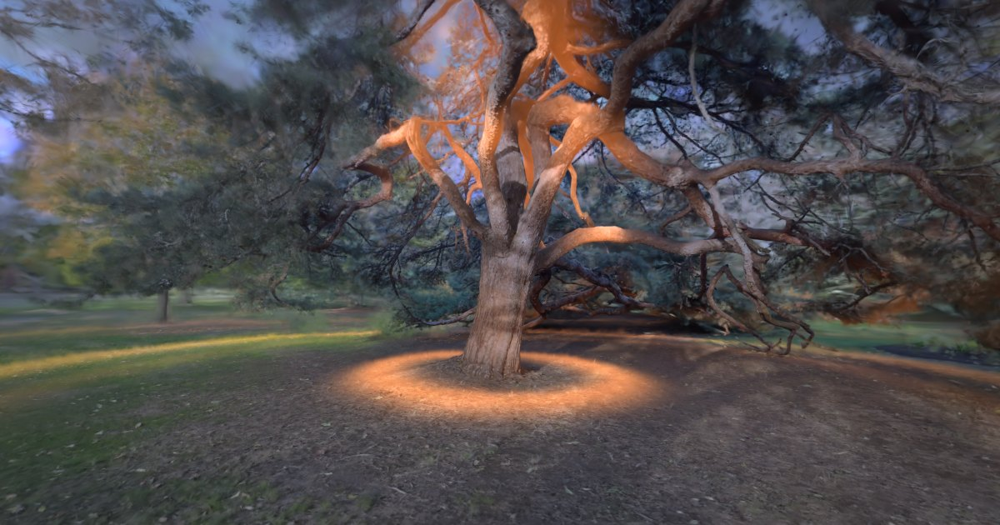

# Heartwood

An old tree, captured as 5.9 million Gaussian splats, that pulses with music. Every heartbeat
sends a ring of light out from the trunk; tap anywhere to send a ripple and play a note. In the
Studio you write your own song, part by part, and the tree draws each part as it plays.

**Live:** https://liftoff-7-xo-sscay4t.apps.hello-xo.nl



Scene: [“tree_360_8-1”](https://superspl.at/scene/6a8be890) by
[wanghongtao](https://superspl.at/user/wanghongtao), licensed
[CC BY 4.0](https://creativecommons.org/licenses/by/4.0/). Modified here with audio-reactive
effects and generated music. Keep the credit visible wherever this is published.

## Run

```
npm install
npm run dev        # http://127.0.0.1:5262
```

`npm run build` writes a static site to `dist/`, and `npm run preview` serves it on port 5263.
The build uses relative paths, so `dist/` can be uploaded to any static host or sub-folder
(Vercel, Netlify, GitHub Pages, an nginx container). Nothing runs on a server.

`og:url` and `og:image` in `index.html` point at the live site; change them if you host it
elsewhere, since link previews need an absolute image URL.

### Docker

The `Dockerfile` builds the site from source and serves it with Caddy on port 3000
(`deploy/Caddyfile`: compression, long caching for the hashed files). The live site runs this
image.

```
docker build -t heartwood .
docker run --rm -p 127.0.0.1:8080:3000 heartwood    # http://127.0.0.1:8080
```

The splats stream at runtime from PlayCanvas's CDN, which allows any origin. To serve them from
your own host instead, run `node scripts/fetch-scene.mjs` (about 126 MB into `public/scene/`) and
set `SCENE.url` in `src/config.js` to `'scene/lod-meta.json'`.

## Play

| Input | Does |
| --- | --- |
| Drag | Orbit (drifts on its own when left alone) |
| Right-drag, two fingers | Pan |
| Scroll, pinch | Zoom |
| Tap | Ripple of light from that point, and a note |
| Double-tap | Move the heart (where beat rings start) there |
| Space | Play / pause |
| 1–4 | Colour: Ember, Aurora, Blossom, Moon |
| P / R / H / O / F | Pulse / reset view / hide UI / auto orbit / fullscreen |

The dock picks the music: three generated moods (Heart 64 bpm, Bloom 116 bpm, Drift ambient),
a track of your own (button, or drop a file anywhere), or the microphone. Pulse sets how strong
the effects are, Dusk grades the scene toward night so the light carries.

URL options: `?renderer=webgl` forces WebGL 2 (WebGPU is used when available), `?debug` shows
frame stats, `?src=<lod-meta.json | .sog | .ply url>&heart=x,y,z` loads another SuperSplat scene.

## Studio

**Studio** in the dock opens a step sequencer for the song the tree plays: chords, melody, bass,
heart (the kick), clap and hats. Each part is one bar of 16 steps, looped under four bars of
chords. The melody's rows are the key's pentatonic scale and the bass's rows are tones of each
bar's chord, so every square is in key, and changing the key or a chord carries the song with it.

| Input | Does |
| --- | --- |
| Tap a square, or drag | Write or clear notes; drum squares go full, soft, off |
| A part's name | Mute it |
| A part's dice | A new pattern for that part |
| A chord | The next chord (right-click: the one before) |
| Dice at the top | A new song: Surprise me, Heart, Bloom, Drift or Blank |
| Pencil | Write the notes you play live into the melody |
| Tap the tree, Z – , | Play the melody's notes live, in key |
| ● | Record what plays; press again to save it as an audio file |
| Link | Copy a link that opens this song (`#s=` and 56 characters) |
| Ctrl+Z, Ctrl+Shift+Z | Undo, redo |

Each part lights the tree its own way. The heart sends rings along the ground; the bass sends
slower, wider rings in the palette's second colour; each chord a slow swell. The melody lights
points on an upright sheet through the trunk: left to right through the bar, higher notes higher
up. Hats sparkle and claps flash. The song is kept in the browser between visits.

## How it works

| File | Role |
| --- | --- |
| `src/scene.js` | PlayCanvas app, camera with bloom and vignette, streaming the splat (coarsest level first), picking |
| `src/pulse.js` | The effect: one `gsplatModifyVS` shader chunk (GLSL for WebGL 2, WGSL for WebGPU) that moves, scales and lights every splat from the music: rings, sway, sparkle, dusk, reveal. It also fades out leaves close to the lens, never the ground |
| `src/music.js` | Generative score on the Web Audio API: heartbeat kick, sub bass, pads, FM plucks and bells, with every note reported on the audio clock |
| `src/audio.js` | Sources (score, studio song, your track, microphone), analysis into bass / mid / high, beat detection for tracks without a score, recording |
| `src/song.js` | Studio songs: keys, scales and chords, the three moods as songs, a generator for each part, 56-character share codes |
| `src/sequencer.js` | Plays a studio song on the score's instruments, reporting each note's part, step and row |
| `src/studio.js` | The studio panel: the grid, painting, chords, key and new-song menus, the playhead |
| `src/orbit.js` | Orbit camera: damped, flick inertia, a slow drift that dips under the low branches on the far side, and how much to clear around the lens |
| `src/ui.js`, `index.html`, `src/style.css` | Intro, dock, about card, drag and drop |
| `src/main.js` | Wires music events to light, taps to ripples, keys, and a quality governor for slow devices |

Rendering: [PlayCanvas engine](https://github.com/playcanvas/engine) 2.24 (MIT).

## Licence

The code is MIT ([LICENSE](LICENSE)). The scene is not in this repository: it streams from
PlayCanvas's CDN and stays under CC BY 4.0, by wanghongtao. `public/og.jpg` is a frame rendered
from it, so the same credit applies to that image.
